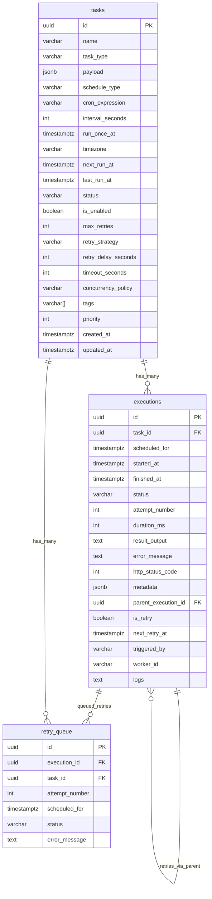

# ER Diagram — Scheduled Task Manager

## Mermaid (for GitHub/README)



## ASCII (for docs without Mermaid)

```
┌─────────────────────────────────────────────────┐
│                     tasks                        │
│  PK id: UUID                                    │
│  name, description, task_type, payload (JSONB)  │
│  schedule_type: cron | interval | once          │
│  cron_expression, interval_seconds, run_once_at │
│  timezone, next_run_at, last_run_at             │
│  status, is_enabled, priority, tags             │
│  max_retries, retry_strategy, retry_delay       │
│  timeout_seconds, concurrency_policy            │
└──────────────────┬──────────────────────────────┘
                   │ 1
                   │ has many
                   ▼ *
┌─────────────────────────────────────────────────┐
│                   executions                     │
│  PK id: UUID                                    │
│  FK task_id → tasks.id  (CASCADE)               │
│  FK parent_execution_id → executions.id (retry) │
│  scheduled_for, started_at, finished_at         │
│  status, attempt_number, duration_ms            │
│  result_output, error_message, http_status_code │
│  is_retry, next_retry_at, triggered_by          │
└──────────────────┬──────────────────────────────┘
                   │ 1
                   │ may queue
                   ▼ *
┌─────────────────────────────────────────────────┐
│                  retry_queue                     │
│  PK id: UUID                                    │
│  FK execution_id, task_id                       │
│  attempt_number, scheduled_for, status          │
└─────────────────────────────────────────────────┘

VIEWS:
  v_task_latest_execution  → latest run per task
  v_task_stats             → counts + avg duration
  v_failed_needing_retry   → retry worker input
```

## Cardinality Notes

- **tasks → executions**: 1 task has 0..N executions. Every scheduler tick + every retry + manual trigger creates an execution.
- **executions → executions (self)**: A failed execution can have N retry children via `parent_execution_id`. Chain depth ≤ `max_retries` (max 10).
- **executions → retry_queue**: Optional 1:1 or 1:N if you want explicit queue visibility. Can be dropped for MVP.

## State Diagram: Execution Lifecycle

```
                    ┌──────────┐
                    │ pending  │◄──── scheduler tick / manual / retry
                    └────┬─────┘
                         │ worker picks up
                    ┌────▼─────┐
               ┌───►│ running  │
               │    └────┬─────┘
               │         │
     timeout   │   ┌─────┴──────┐
     skip      │   │  outcome   │
               │   └─────┬──────┘
               │   ┌─────┼──────┐
               │   ▼     ▼      ▼
          ┌────────┐ ┌──────┐ ┌─────────┐
          │timeout │ │success│ │ failed  │─── max_retries? ──► exhausted (no retry)
          │skipped │ └──────┘ └────┬────┘
          └────────┘                │ has retries left
                                    ▼
                              next_retry_at set
                                    │
                              retry worker
                                    │
                              ┌─────▼─────┐
                              │ pending   │ (is_retry=true, attempt_number++)
                              └───────────┘
```
