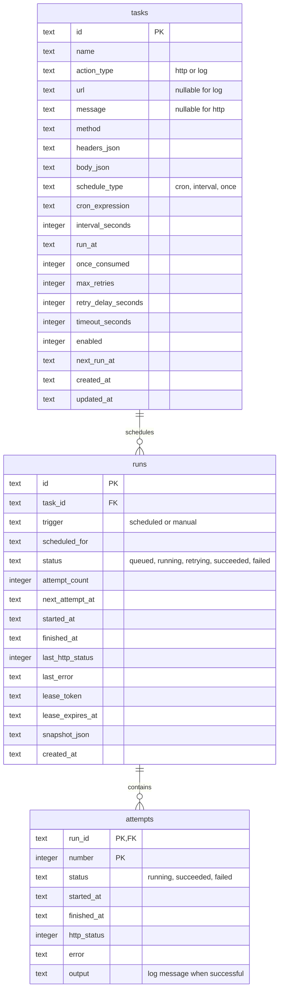

# Runtime ER diagram

The integrated FastAPI service uses the SQLite v2 schema in
[`database/schema.sqlite.sql`](../database/schema.sqlite.sql). The database team's
[original PostgreSQL design](design/ER_DIAGRAM.postgres-proposed.md) is preserved
for reference, but it is not the runtime model.

- A task owns many runs; a run owns numbered attempts. Foreign keys cascade
  deletions. A partial unique index permits at most one unfinished run per task.
- `runs.snapshot_json` freezes action and retry settings when a run is queued;
  leases prevent multiple workers from claiming the same attempt concurrently.
- Times are stored as fixed-width UTC text. `v_task_stats` and
  `v_failed_needing_retry` are read-only monitoring views, not extra tables.
- There is no runtime `executions` or `retry_queue` table. See the
  [database guide](../database/README.md) for migrations and limitations.
